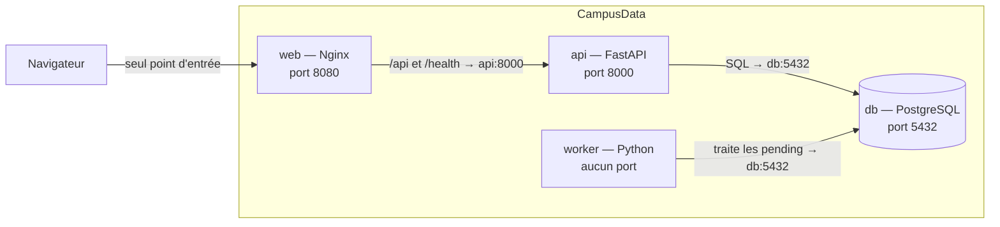
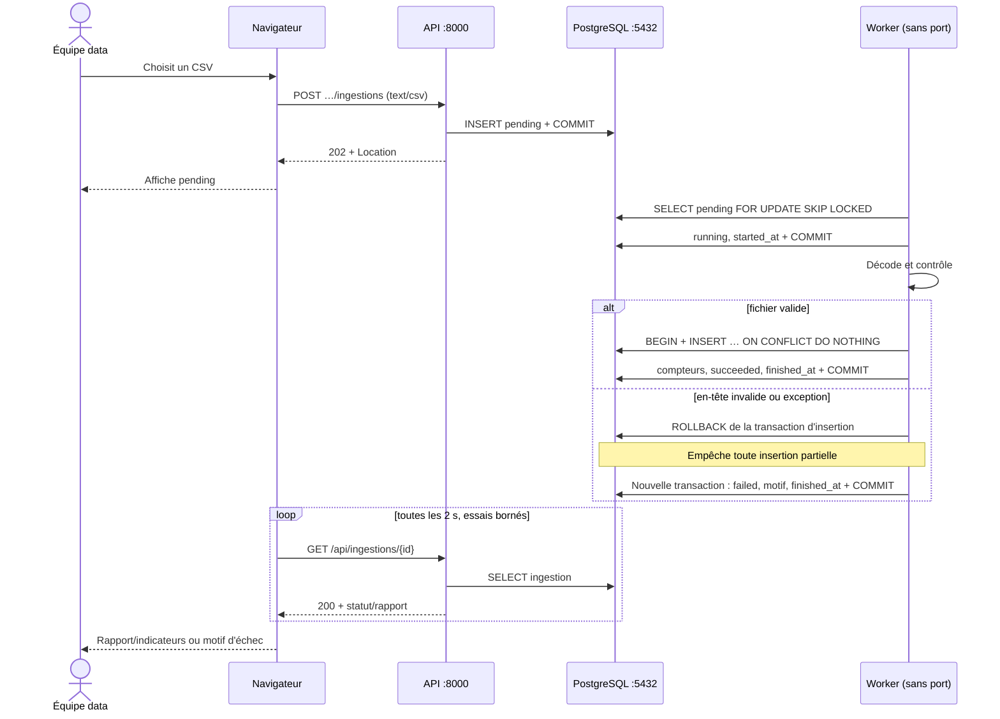
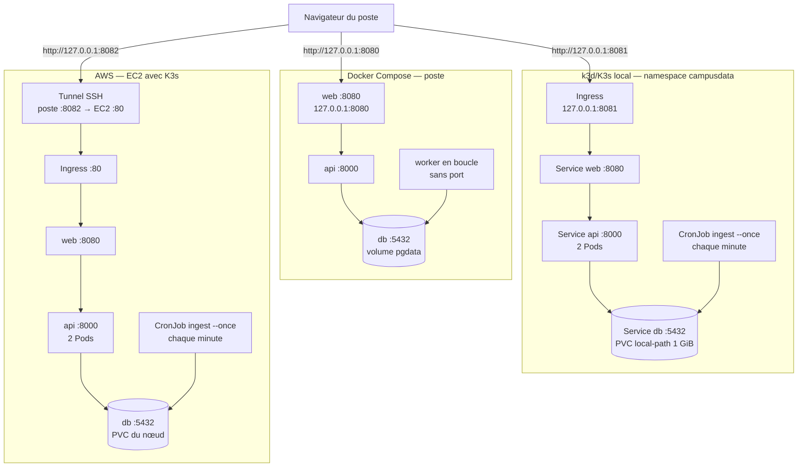
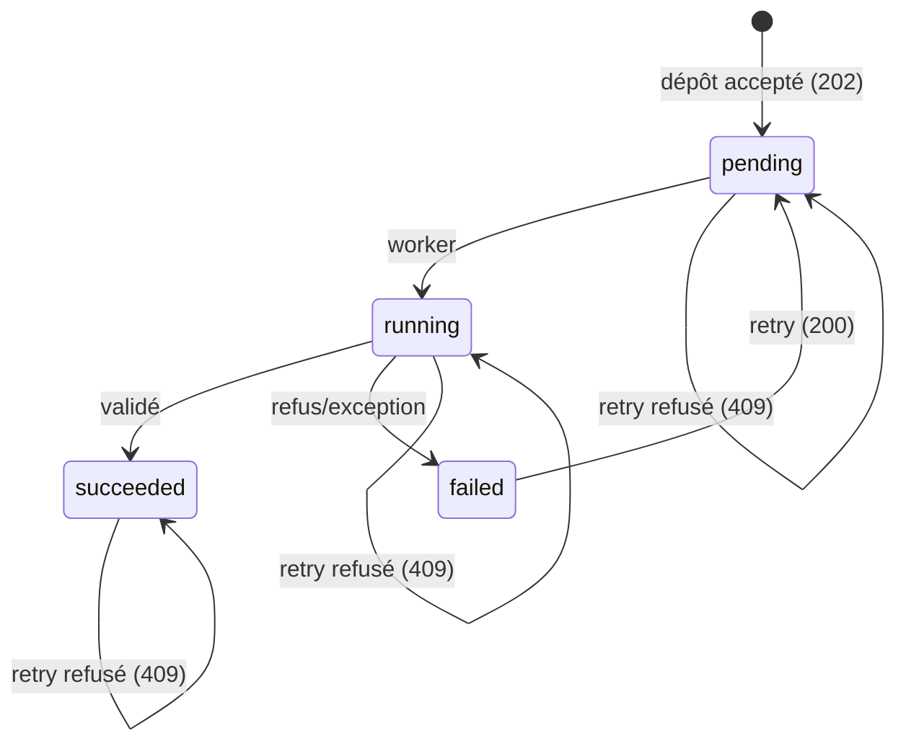

# Dossier de conception — CampusData

**Membres :** Membre A / Membre B *(à remplacer par les noms du binôme)*.  
**Version :** S1 — 2026-11-17. **Relecteur :** à compléter après la revue croisée.

Ce document décrit la cible décidée en séance 1. Le dépôt contient encore le
socle minimal ; les routes métier, tables et worker seront réalisés en séance 2.

Références : [séance 1](https://mtbinds.github.io/AIVANCITY-PROJECT/en/projet/seances/01-conception/),
[conception détaillée](https://mtbinds.github.io/AIVANCITY-PROJECT/en/projet/conception/conception-detaillee/)
et [énoncé](https://mtbinds.github.io/AIVANCITY-PROJECT/en/projet/).

## 1. Besoin et utilisateurs — tâche 1

1. L'utilisateur principal est l'équipe data ; le jury et l'étudiant opérateur
   vérifient et exploitent le produit, mais ne sont pas des rôles authentifiés.
2. Les exports CSV des capteurs sont aujourd'hui copiés manuellement dans un
   tableur, ce qui crée erreurs, doublons et indicateurs non reproductibles.
3. L'utilisateur crée un jeu de données, y dépose un CSV, suit son traitement,
   puis consulte le rapport de rejets et les indicateurs par salle.
4. L'application conserve durablement jeux, fichiers déposés, états, rapports et
   mesures valides, sans stocker deux fois la même mesure.
5. Le prototype exclut connexion utilisateur, droits applicatifs, IA, temps réel
   et données réelles ; `owner` est une valeur déclarative, pas un compte.

**Résultat attendu.** Centraliser les mesures fictives de CO₂, température et
humidité, expliquer les rejets et produire des indicateurs recalculables, tout en
permettant de redéposer un fichier sans dupliquer les mesures.

### Démonstration nominale en six actions

1. Ouvrir l'application vide.
2. Créer « Qualité de l'air — bâtiment A ».
3. Déposer `mesures-salles-2026-10-05.csv`.
4. Voir `pending`, puis attendre `succeeded`.
5. Lire les 63 mesures et les indicateurs des trois salles.
6. Redéposer le fichier et constater 0 acceptée, 63 doublons et toujours 63 mesures.

**Cas d'erreur.** Déposer `en-tete-invalide.csv` : après le `202 pending`, le
worker détecte l'en-tête incorrect, annule toute insertion et place le dépôt en
`failed` avec `Invalid header`. L'interface affiche le motif et **Relancer**.

## 2. Backlog et critères d'acceptation — tâche 2

Les rôles A/B doivent être remplacés par les noms du binôme. Chaque US est
réalisée, testée et documentée par son responsable, avec revue croisée.
Dans les deux dernières colonnes, les trois segments séparés par `/` sont,
respectivement, **Étant donné / Quand / Alors**.

| ID | Besoin utilisateur | Priorité / responsable | Critère positif (Étant donné / Quand / Alors) | Critère d'erreur (Étant donné / Quand / Alors) |
|---|---|---|---|---|
| US01 | Créer un dataset | Must / A | Liste vide / je crée « Bâtiment A » / `201`, dataset visible et compteur 0. | Nom déjà pris / je le recrée / `409 Dataset name already exists`, aucun doublon. |
| US02 | Lister et ouvrir les datasets | Must / B | Plusieurs datasets / je liste / tri décroissant, compteurs visibles ; un dataset connu s'ouvre en `200`. | UUID valide inconnu / je l'ouvre / `404 Dataset not found`. |
| US03 | Supprimer un dataset | Must / A | Dataset avec dépôts et mesures / je confirme / `204` sans corps et suppression en cascade. | Je choisis Annuler / je ferme la confirmation / aucune requête, données intactes. |
| US04 | Déposer un CSV | Must / B | CSV `text/csv`, non vide, ≤ 1 Mio / je dépose / `202`, `Location`, statut `pending`. | Corps vide / je dépose / `422 Empty file`, aucun dépôt créé. |
| US05 | Voir le dépôt traité | Must / A | Dépôt `pending` / le worker le prend / `running` puis `succeeded` ou `failed`, dates et compteurs cohérents. | En-tête invalide / le worker traite / rollback, `failed`, aucune mesure insérée. |
| US06 | Voir lignes rejetées et motifs | Must / B | Fichier d'erreurs dans un dataset vide / traitement fini / 12 lues, 4 acceptées, 7 rejetées, 1 doublon. | Plus de 20 lignes invalides / traitement / toutes comptées, seules les 20 premières détaillées. |
| US07 | Redéposer sans doublons | Must / A | 63 mesures déjà présentes / même fichier redéposé / 0 acceptée, 63 doublons, total inchangé. | Deux workers concurrents / mêmes mesures insérées / contrainte `UNIQUE` empêche tout doublon. |
| US08 | Voir indicateurs par salle/période | Must / B | 63 mesures / filtre A101 / 21 mesures, CO₂ moyen 636,1, min 430, max 1092. | `from >= to` / je filtre / `422`, aucun résultat trompeur affiché. |
| US09 | Relancer un dépôt échoué | Should / A | Dépôt `failed` / je relance / `200 pending`, compteurs, erreurs et dates de traitement réinitialisés. | Dépôt `pending`, `running` ou `succeeded` / je relance / `409`, aucun changement. |
| US10 | Compter sur un service fiable | Must / B | Jeu témoin de 63 mesures / DB remplacée sans supprimer son stockage / id, compte et somme CO₂ 46 504 retrouvés. | DB indisponible / sondes appelées / readiness `503`, liveness `200`, aucun `pending` perdu. |

Preuves prévues : tests API pour codes et corps, tests unitaires du parseur, tests
worker/transactions, inspection réseau du navigateur et preuve de persistance.

## 3. Maquettes et interactions — tâche 3

### Écran 1 — datasets et création

```text
┌──────────────────────────────────────────────────────────────────────────┐
│ CampusData                                        Version : abc123…      │
├──────────────────────────────────────────────────────────────────────────┤
│ Nouveau dataset                                                         │
│ Nom *       [ Qualité de l'air — bâtiment A________________________ ]    │
│ Description [ _____________________________________________________ ]    │
│ Responsable [ Équipe A____________ ]  [ Créer ]                         │
│ Message : Dataset créé / Nom déjà pris / Service indisponible           │
├──────────────────────────────────────────────────────────────────────────┤
│ Nom                         Responsable   Mesures   Créé le     Actions   │
│ Qualité de l'air — bât. A   Équipe A           63   16/11/26   [Ouvrir] │
│                                                               [Supprimer]│
└──────────────────────────────────────────────────────────────────────────┘
```

| État | Affichage |
|---|---|
| Chargement | « Chargement des datasets… », actions indisponibles. |
| Vide | « Aucun dataset. Créez le premier ci-dessus. » |
| Données | Tableau trié, compteur, **Ouvrir** et **Supprimer**. |
| Erreur | Alerte « Impossible de charger » et **Réessayer**. |

`Nom` est obligatoire ; description vide part en `null`, owner absent vaut
`Team`. Pendant la mutation, **Créer** est désactivé puis réactivé dans `finally`.
Après une erreur, les saisies restent. La suppression confirme le nom et le
nombre de mesures ; **Annuler** n'envoie rien. Toutes les valeurs utilisent
`textContent`, donc un nom `<script>` reste du texte.

### Écran 2 — dépôts et indicateurs d'un dataset

```text
┌──────────────────────────────────────────────────────────────────────────┐
│ ← Datasets  Qualité de l'air — bâtiment A                63 mesures      │
├──────────────────────────────────────────────────────────────────────────┤
│ Déposer un CSV [Choisir] [Déposer]                                      │
│ Dépôts [Tous ▾] [Actualiser]                                            │
│ Fichier              Statut     Accept. Rejet. Doubl. Heure    Action    │
│ mesures.csv          pending       —      —      —   10:44    Traitement…│
│ erreurs.csv          succeeded     4      7      1   10:42    [Rapport] │
│ mauvais-en-tete.csv  failed        —      —      —   10:40    [Relancer]│
├──────────────────────────────────────────────────────────────────────────┤
│ Indicateurs Salle [Toutes ▾] Du [date] Au [date] [Filtrer]               │
│ Salle Mesures CO₂ moy. Min Max Temp. moy. Hum. moy. Dernière             │
│ A101       21     636,1 430 1092      20,3      44,2 05/10 18:00        │
└──────────────────────────────────────────────────────────────────────────┘
```

| Liste | Chargement | Vide | Données | Erreur |
|---|---|---|---|---|
| Dépôts | « Chargement… » | « Aucun dépôt » | Statut, compteurs, rapport/relance | Message + réessai |
| Indicateurs | « Calcul… » | « Aucune mesure pour ces filtres » | Agrégats par salle | Message, filtres conservés |

`202` affiche `pending`, jamais « traité ». Le navigateur suit le `Location`
toutes les 2 s, avec un nombre d'essais borné, jusqu'à `succeeded`/`failed`.
Seul `failed` propose **Relancer**. Tous les champs ont un `<label>`, les boutons
sont utilisables au clavier, les tableaux ont `<caption>` et `<th scope="col">` ;
succès et erreurs sont annoncés avec `role="status"` et `role="alert"`.

## 4. Architecture et flux — tâche 6

### Composants



Le navigateur emploie des URL relatives (`/api/datasets`) : il ne peut résoudre
ni `api` ni `db`. Le worker interroge la DB et n'expose aucun port.

### Séquence d'un dépôt, succès ou refus



### Déploiement



| Contexte | Point d'entrée | Web → API | API/worker → DB | Worker | Stockage durable |
|---|---|---|---|---|---|
| Développement | `127.0.0.1:8080` | `host.docker.internal:8000` ; API aussi sur `127.0.0.1:8000` | `127.0.0.1:5432` | terminal, `python -m app.worker --once` | volume `devpgdata` |
| Compose | `127.0.0.1:8080` | `api:8000` | `db:5432` | service en boucle, 5 s | volume `pgdata` |
| k3d | `127.0.0.1:8081` via Ingress | Service `api:8000` | Service `db:5432` | CronJob chaque minute | PVC `pgdata`, `local-path`, 1 GiB |
| AWS/K3s | `127.0.0.1:8082` via tunnel vers EC2 `:80` | Service `api:8000` | Service `db:5432` | même CronJob | PVC local au nœud : persistant au Pod, non répliqué et non sauvegardé |

`.env` injecte les secrets dans Compose ; un Secret Kubernetes les fournit à
l'API, au worker et à PostgreSQL. Base64 n'est pas un chiffrement. L'API et la DB
restent internes et ne sont jamais publiées sur Internet.

## 5. Données et contrat HTTP — tâches 4 et 5

### Modèle relationnel

Supprimer un dataset supprime ses ingestions et mesures (`ON DELETE CASCADE`).
Le serveur génère les UUID v4 et `created_at` ; le worker génère `started_at` et
`finished_at`. Tous sont des `TIMESTAMPTZ`, stockés et renvoyés en UTC (`Z`).

#### `datasets`

| Colonne | Type | Null ? | Contraintes / valeur initiale |
|---|---|---:|---|
| `id` | `UUID` | Non | PK, UUID v4 serveur, immuable |
| `name` | `VARCHAR(120)` | Non | trim, 3–120, `UNIQUE`, requis |
| `description` | `TEXT` | Oui | ≤ 2 000 caractères, défaut `NULL` |
| `owner` | `VARCHAR(60)` | Non | trim, 2–60, défaut `Team` |
| `created_at` | `TIMESTAMPTZ` | Non | date UTC serveur, immuable |

`measurement_count` est calculé, pas stocké. À la création : `name` absent,
`null` ou vide → `422`; `description` absente ou `null` → `null`; `owner` absent
→ `Team`, mais `null` ou vide → `422`. Tout champ inconnu est refusé
(`extra="forbid"`).

#### `ingestions`

| Colonne | Type | Null ? | Contraintes / valeur initiale |
|---|---|---:|---|
| `id` | `UUID` | Non | PK, UUID v4 serveur |
| `dataset_id` | `UUID` | Non | FK `datasets.id`, cascade, valeur de l'URL |
| `filename` | `VARCHAR(255)` | Non | 1–255, sans `/` ni `\` |
| `status` | `VARCHAR(10)` | Non | `pending/running/succeeded/failed`, défaut `pending` |
| `content` | `BYTEA` | Non | octets bruts ≤ 1 048 576, jamais exposés |
| `rows_total` | `INTEGER` | Oui | lignes lues hors en-tête, défaut `NULL` |
| `rows_accepted` | `INTEGER` | Oui | insérées, défaut `NULL` |
| `rows_rejected` | `INTEGER` | Oui | invalides, défaut `NULL` |
| `rows_duplicate` | `INTEGER` | Oui | valides déjà présentes, défaut `NULL` |
| `errors` | `JSONB` | Non | ≤ 20 objets `{line, reason}`, défaut `[]` |
| `error_message` | `TEXT` | Oui | motif global d'échec, défaut `NULL` |
| `created_at` | `TIMESTAMPTZ` | Non | date UTC du dépôt |
| `started_at` | `TIMESTAMPTZ` | Oui | worker, défaut `NULL` |
| `finished_at` | `TIMESTAMPTZ` | Oui | worker, défaut `NULL` |

Pour `succeeded`, un `CHECK` impose `rows_total = rows_accepted + rows_rejected
+ rows_duplicate`. L'index `(status, created_at)` accélère la recherche des
`pending`, au prix d'une mise à jour d'index à chaque changement d'état.

#### `measurements`

| Colonne | Type | Null ? | Contraintes |
|---|---|---:|---|
| `id` | `BIGINT IDENTITY` | Non | PK technique, non exposée |
| `dataset_id` | `UUID` | Non | FK `datasets.id`, cascade |
| `ingestion_id` | `UUID` | Non | FK `ingestions.id`, cascade |
| `room` | `VARCHAR(30)` | Non | trim, 1–30 caractères |
| `measured_at` | `TIMESTAMPTZ` | Non | ISO 8601 avec fuseau |
| `co2_ppm` | `INTEGER` | Non | `CHECK` 250–10 000 |
| `temperature_c` | `NUMERIC(4,1)` | Non | `CHECK` -30–60 |
| `humidity_pct` | `NUMERIC(4,1)` | Non | `CHECK` 0–100 |

`UNIQUE (dataset_id, room, measured_at)` garantit l'idempotence, y compris face
à deux workers, et sert aux indicateurs. Les contrôles worker donnent des motifs
lisibles ; les contraintes SQL protègent toutes les écritures.

| Mesure | Valide | Invalide |
|---|---|---|
| `co2_ppm` | `712` | `10001` ou `abc` |
| `temperature_c` | `20.8` | `-30.1` |
| `humidity_pct` | `46.3` | `101` |

### Format et contrôles CSV

```csv
room,measured_at,co2_ppm,temperature_c,humidity_pct
A101,2026-10-05T09:00:00+02:00,712,20.8,46.3
```

Le fichier est UTF-8, séparé par virgules, avec cet en-tête exact. Chaque ligne
est contrôlée dans l'ordre ; seul le premier motif cassé est conservé.

| # | Règle | Motif |
|---:|---|---|
| 1 | exactement 5 colonnes | `Expected 5 columns` |
| 2 | room trim, 1–30 | `Invalid room` |
| 3 | date ISO 8601 avec fuseau | `Invalid measured_at` |
| 4 | date au plus 5 min dans le futur | `measured_at in the future` |
| 5 | CO₂ entier 250–10 000 | `Invalid co2_ppm` |
| 6 | température numérique -30–60 | `Invalid temperature_c` |
| 7 | humidité numérique 0–100 | `Invalid humidity_pct` |

Les lignes vides sont ignorées. Un doublon dans le dataset ou plus tôt dans le
fichier est compté, pas rejeté. Tous les rejets comptent, mais seuls les 20
premiers sont détaillés. Le temps courant est injecté dans le test de la règle 4.

| Cas | Exemple | Résultat |
|---|---|---|
| Ligne invalide | `co2_ppm=abc` | rejetée et comptée ; traitement poursuivi |
| Fichier invalide | non-UTF-8, mauvais en-tête, aucune donnée, > 10 000 lignes | `failed`, rollback, 0 mesure |
| Doublon | même dataset, salle et instant | ignoré et compté comme doublon |
| Corps vide | 0 octet | API `422 Empty file`, aucun dépôt |
| Trop gros | > 1 048 576 octets | API `413 File too large`, aucun dépôt |
| Mauvais type | autre que `text/csv` | API `415 Expected text/csv`, aucun dépôt |



Une relance permise remet compteurs, erreurs, message, `started_at` et
`finished_at` à leur valeur initiale. Le client ne choisit jamais le statut.

### Contrat HTTP

Toutes les routes métier sont sous `/api`. Les réponses sont JSON sauf le `204`
sans corps. Nginx conserve le préfixe.

| Méthode et route | Entrée | Succès | Erreurs |
|---|---|---|---|
| `GET /api/datasets` | — | `200`, liste triée date puis id décroissants | `503` |
| `POST /api/datasets` | JSON `DatasetCreate` | `201 DatasetRead` | `422`, `409`, `503` |
| `GET /api/datasets/{id}` | UUID | `200 DatasetRead` | `422`, `404`, `503` |
| `DELETE /api/datasets/{id}` | UUID | `204`, vide, cascade | `422`, `404`, `503` |
| `POST /api/datasets/{id}/ingestions?filename=…` | corps `text/csv` | `202 pending` + `Location` | `415`, `413`, `422`, `404`, `503` |
| `GET /api/datasets/{id}/ingestions?status=…` | statut facultatif | `200`, liste par date décroissante | `422`, `404`, `503` |
| `GET /api/ingestions/{id}` | UUID | `200 IngestionRead`, sans contenu brut | `422`, `404`, `503` |
| `POST /api/ingestions/{id}/retry` | — | `200 pending` | `422`, `404`, `409`, `503` |
| `GET /api/datasets/{id}/stats?room=&from=&to=` | filtres ; from inclus, to exclu | `200`, salles triées | `422`, `404`, `503` |
| `GET /api/version` | — | `200 {"version":"<commit>"}` | sans DB |
| `GET /health/live` | — | `200 {"status":"ok"}` | sans DB |
| `GET /health/ready` | — | `200 {"status":"ready"}` | `503` si DB/table absente |

Ordre : validation (`422/415/413`), ressource (`404`), règle (`409`), sauvegarde.
Une panne de connexion DB devient `503`. Une erreur inattendue devient `500`
générique ; sa trace reste dans les logs et aucun DSN/secret n'est exposé.

| Code | Corps |
|---:|---|
| `404` | `{"detail":"Dataset not found"}` ou `Ingestion not found` |
| `409` | `{"detail":"Dataset name already exists"}` ou `Ingestion cannot be retried` |
| `413` | `{"detail":"File too large"}` |
| `415` | `{"detail":"Expected text/csv"}` |
| `422` | liste FastAPI, ou chaîne pour fichier vide/période invalide |
| `503` | `{"detail":"Database unavailable"}` |

Le frontend accepte donc `detail` chaîne ou liste et un éventuel corps non JSON.

### Exemples HTTP complets

#### Création — `201 Created`

```http
POST /api/datasets HTTP/1.1
Content-Type: application/json

{"name":"Air quality - building A","owner":"Team A"}
```

```http
HTTP/1.1 201 Created
Content-Type: application/json

{"id":"6b1e7c0a-3f4d-4d0e-9a51-2d8f0c7a1b23","name":"Air quality - building A","description":null,"owner":"Team A","created_at":"2026-11-16T10:00:00Z","measurement_count":0}
```

#### Dépôt — `202 Accepted`

```http
POST /api/datasets/6b1e7c0a-3f4d-4d0e-9a51-2d8f0c7a1b23/ingestions?filename=mesures-avec-erreurs.csv HTTP/1.1
Content-Type: text/csv

room,measured_at,co2_ppm,temperature_c,humidity_pct
A101,2026-10-06T08:00:00+02:00,455,19.6,43.0
```

```http
HTTP/1.1 202 Accepted
Content-Type: application/json
Location: /api/ingestions/1d9c4f2e-8b7a-4c61-9e0d-5a3b2c1d0e9f

{"id":"1d9c4f2e-8b7a-4c61-9e0d-5a3b2c1d0e9f","dataset_id":"6b1e7c0a-3f4d-4d0e-9a51-2d8f0c7a1b23","filename":"mesures-avec-erreurs.csv","status":"pending","rows_total":null,"rows_accepted":null,"rows_rejected":null,"rows_duplicate":null,"errors":[],"error_message":null,"created_at":"2026-11-16T10:42:00Z","started_at":null,"finished_at":null}
```

#### Lecture après traitement — `200 OK`

```http
GET /api/ingestions/1d9c4f2e-8b7a-4c61-9e0d-5a3b2c1d0e9f HTTP/1.1
```

```http
HTTP/1.1 200 OK
Content-Type: application/json

{
  "id":"1d9c4f2e-8b7a-4c61-9e0d-5a3b2c1d0e9f",
  "dataset_id":"6b1e7c0a-3f4d-4d0e-9a51-2d8f0c7a1b23",
  "filename":"mesures-avec-erreurs.csv",
  "status":"succeeded",
  "rows_total":12,
  "rows_accepted":4,
  "rows_rejected":7,
  "rows_duplicate":1,
  "errors":[
    {"line":5,"reason":"Invalid co2_ppm"},
    {"line":6,"reason":"Invalid humidity_pct"},
    {"line":7,"reason":"Invalid measured_at"},
    {"line":8,"reason":"Invalid room"},
    {"line":9,"reason":"measured_at in the future"},
    {"line":10,"reason":"Invalid temperature_c"},
    {"line":12,"reason":"Expected 5 columns"}
  ],
  "error_message":null,
  "created_at":"2026-11-16T10:42:00Z",
  "started_at":"2026-11-16T10:42:03Z",
  "finished_at":"2026-11-16T10:42:03Z"
}
```

#### Relance d'un dépôt réussi — `409 Conflict`

```http
POST /api/ingestions/1d9c4f2e-8b7a-4c61-9e0d-5a3b2c1d0e9f/retry HTTP/1.1
```

```http
HTTP/1.1 409 Conflict
Content-Type: application/json

{"detail":"Ingestion cannot be retried"}
```

#### Fichier trop volumineux — `413 Content Too Large`

```http
POST /api/datasets/6b1e7c0a-3f4d-4d0e-9a51-2d8f0c7a1b23/ingestions?filename=large.csv HTTP/1.1
Content-Type: text/csv
Content-Length: 1048577

…
```

```http
HTTP/1.1 413 Content Too Large
Content-Type: application/json

{"detail":"File too large"}
```

#### Suppression — `204 No Content`

```http
DELETE /api/datasets/6b1e7c0a-3f4d-4d0e-9a51-2d8f0c7a1b23 HTTP/1.1
```

```http
HTTP/1.1 204 No Content
```

## 6. Découpage du code et transactions — préparation de la séance 2

Cette section sera finalisée en séance 2 d'après le code réel. La cible est
`routes.py` → `services.py` → `database.py`/`models.py`, avec `ingestion.py` pur
et `worker.py` séparé. Une session par requête/unité de travail possède son
commit, fait rollback sur échec et est toujours fermée. L'initialisation est
explicite via `python -m app.init_db` : `create_all` crée un schéma absent mais ne
migre pas une table existante.

## 7. Décisions argumentées — décisions de la tâche 6

| Décision | Option | Alternative | Motif | Limite acceptée | Preuve |
|---|---|---|---|---|---|
| Stockage | PostgreSQL partout, y compris contenu brut et `pending` | Fichiers locaux/file séparée | Une transaction conserve dépôt, statut, rapport et mesures ; la file survit aux redémarrages | `BYTEA` convient au plafond de 1 Mio, pas à de gros fichiers | Table ingestions, volume/PVC, US10 |
| Traitement | Worker séparé ; API sauvegarde et répond `202` | Traitement dans la requête | API rapide, travail observable et indépendant du navigateur | Cohérence éventuelle et polling ; récupération d'un `running` bloqué laissée en extension | Séquence et US05 |
| Idempotence | `UNIQUE (dataset_id, room, measured_at)` + `ON CONFLICT DO NOTHING` | Vérification Python seule | Protection atomique contre concurrence et écritures hors API | Coût d'index à l'écriture | US07 : 0 acceptée, 63 doublons |

## 8. Risques et mesures

À compléter lors des séances d'infrastructure et d'exploitation.

## 9. Validation croisée

À compléter après la revue : noms, ambiguïtés trouvées, corrections appliquées
et écarts entre cette conception et la réalisation finale.
